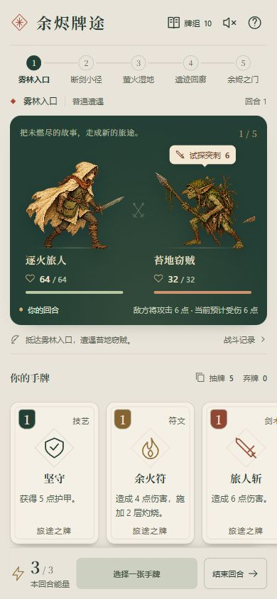

# 余烬牌途 · Ember Card Path

一款原创奇幻题材的单人卡牌策略网页游戏。以剑术、符文和防御牌组成牌组，穿过五场遭遇，挑战枯冠守望者。

**原生 HTML / CSS / JavaScript · 无运行依赖 · 手机与桌面 · MIT**

[在线试玩](https://ember-card-path-1025.lxy1243797305.chatgpt.site) · [MIT 许可证](LICENSE) · [素材来源](THIRD_PARTY_NOTICES.md)

在线试玩域名在部分中国大陆网络下可能无法直连，可以下载源码本地运行或导出单文件离线版。



## 开始游戏

下载本仓库后，用浏览器打开 `dist/index.html` 即可开始。推荐使用本地服务器，以获得更稳定的本地存档体验：

```sh
git clone https://github.com/lxy1243797305-debug/ember-card-path.git
cd ember-card-path
node server.cjs
```

打开 [http://localhost:4173](http://localhost:4173)。需要 Node.js 20 或更新版本，无需 `npm install`。

## 玩法

- 每回合抽五张牌、恢复三点能量。点手牌查看效果，再点“打出”。
- 敌方意图提前可见，可以选择进攻、防御或准备连招。
- 护甲抵挡伤害，在你的下回合清空；灼烧在敌人行动前结算，再减少一层。
- 蓄势强化下一张剑术牌的每次伤害，可与连击配合。
- 胜利恢复四点生命，并选择一张新卡加入牌组，也可以跳过。
- 第二场之后的篝火可以恢复生命或精炼卡牌。
- 共五场遭遇，包含最终首领；目前共有十三种卡牌。

牌组、抽弃牌堆、战斗记录和玩法说明都可在界面内查看。音效默认关闭。存档仅保存在当前浏览器，不会跨设备同步。

## 导出单文件离线版

```sh
node export-offline.cjs
# 或指定输出路径：
node export-offline.cjs ./build/my-game.html
```

默认生成 `build/ember-card-path-offline.html`，图片、字体和脚本均已内置，运行时不请求外部资源。电脑可用浏览器直接打开；手机需使用支持本地 HTML 的浏览器，聊天软件的文件预览通常不能运行游戏。

## 开发与测试

```sh
node --test tests/engine.cjs
node --check dist/app.js
node --check dist/engine.js
```

规则引擎支持种子随机数和状态序列化。十一项测试覆盖护甲、灼烧、蓄势连击、穿甲、洗牌、选卡、篝火精炼与胜负结算。

```text
dist/
  index.html       页面结构
  style.css        响应式战斗界面
  app.js           交互、存档、合成音效
  engine.js        独立战斗规则
  assets/          角色图集、图标和字体
tests/engine.cjs   规则测试
server.cjs        本地静态服务器
export-offline.cjs 单文件导出工具
DESIGN.md         冒险者手札视觉规范
ART-PROMPT.md     AI 美术生成记录
```

修改卡牌和敌人：编辑 `dist/engine.js` 中的 `CARDS`、`ENEMIES`。修改界面：编辑 `dist/app.js` 和 `dist/style.css`。自托管字体使用 Noto Serif SC 子集，新增文字缺字时会使用系统宋体回退；详见素材说明。

## 当前范围

这是用于验证玩法的 v0.1 原型。尚无账号系统、云存档、多人模式或原生安卓安装包，难度与长期平衡仍需试玩反馈。

欢迎提交 Issue 和 Pull Request，见 [贡献指南](CONTRIBUTING.md)。

## 许可与制作说明

项目代码和原创 SVG 图标采用 [MIT](LICENSE)。角色图集由 OpenAI 图像生成工具生成，完整提示词与来源记录已包含在仓库中；该图集也按项目 MIT 条款提供。第三方字体保持 **SIL Open Font License 1.1**，许可证原文随字体分发，见 [第三方说明](THIRD_PARTY_NOTICES.md)。

该原型在作者指导下使用 AI 辅助开发与美术制作。
